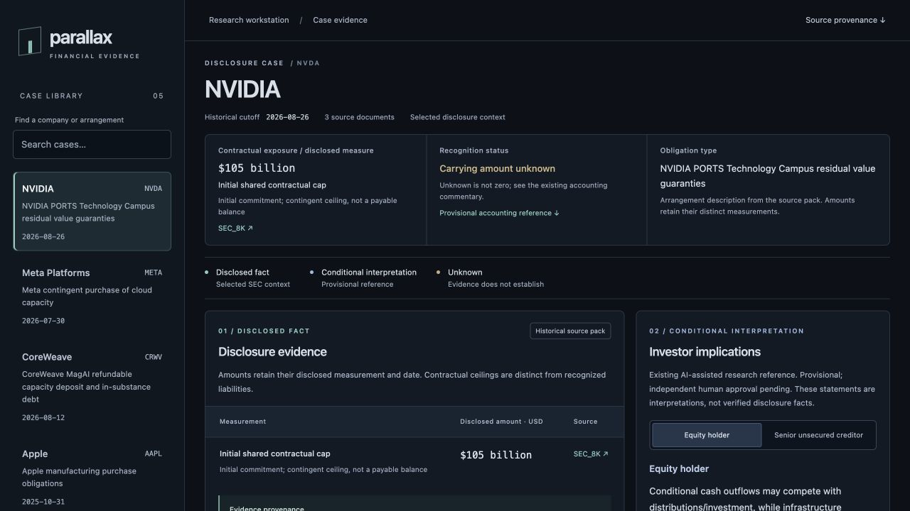

# React evidence workstation — Phase 1

## Run locally

Requirements: Python 3.10+ (the existing project environment), uv, and Node
22.12+, 24+, or 26+ matching `frontend/package.json`'s engines range. No API key
is needed. From the repository root:

```sh
uv sync --locked
npm ci --prefix frontend
npm run build --prefix frontend
uv run python -m parallax.workstation --port 8001
```

Open <http://127.0.0.1:8001>. The standard-library Python server serves the
production build and exactly two read-only JSON routes. It binds to loopback.
Use `--port PORT` to change the port when serving the production build.
Stop with Ctrl+C.

For development with hot reload, run these in two terminals from the root:

```sh
uv run python -m parallax.workstation --port 8001
```

```sh
npm run dev --prefix frontend
```

Keep both terminals running and open <http://127.0.0.1:5174>. Vite proxies
relative `/api` requests to `http://127.0.0.1:8001`; update both proxy targets
in `frontend/vite.config.ts` if changing the Python API port. Starting Vite alone
does not start Python. No CORS change is needed for these same-origin requests.
`npm run preview --prefix frontend` serves port 4174, also proxies the API, and
requires a build plus the running Python service. Vite's dev and preview ports
are fixed and fail if occupied. These defaults avoid Metis's ports 8000/5173.
Reuse existing Parallax servers or stop them before launching duplicates.

The original app still runs separately:

```sh
uv run streamlit run streamlit_app.py
```

## Interface



The workstation has a restrained dark palette, a searchable five-company case
library and a dated arrangement header. A compact summary reuses the existing
disclosed measure, recognition status and source-pack arrangement description;
unknown quantities stay explicit. Microsoft pairs the existing undiscounted
lease payments with the existing recognized balance, without calculating either.
On wide screens, source evidence occupies
the main column and interpretation and limits sit alongside it. Smaller screens
stack the panels; the amount table scrolls within its panel. Keyboard focus,
search labels, selected-case state, a skip link and semantic tables support
accessible navigation.

Three numbered categories distinguish disclosed facts (teal), conditional
interpretation (blue) and unknown/unsupported conclusions (amber), with text
labels as well as color. The amount table names each measurement, its date or
qualifications, and its original SEC source. Document cards preserve the existing
paraphrases, filing/period dates and locators. Each passage, quotation and accession
expands on demand while its original SEC link remains visible. Long paraphrases
are divided into shorter paragraphs without changing their text. The investor
control switches between the existing equity-holder
and senior-unsecured-creditor interpretations. Accounting boundaries and
material unknowns remain visible. Source file paths and SHA-256 hashes are
available under provenance. Loading, failure/retry, no search matches and missing
data each have explicit states.

## Integration and provenance

- `GET /api/cases` returns the five case summaries.
- `GET /api/cases/{key}` returns one evidence pack, amount display selections,
  accounting commentary, conditional interpretations, limitations and provenance.
- Other API routes return 404. There are no write or inference endpoints.
- `parallax/workstation.py` reuses `benchmark.load_case`, `read_json` and
  `digest`. The first three source packs come from the existing registry.
  Apple and Microsoft are read directly from their existing frozen fixtures;
  the scientific registry/protocols are not extended or rewritten.
- All interpretations, accounting commentary and case limitations are reproduced
  from `protocols/scientific-validation-v1/references.json`. The UI explicitly
  identifies their provisional, AI-assisted status and pending independent human
  approval. Its `source_checked_facts` answer targets and experiment scores are
  not presented as certified facts.
- The evidence panel shows the source packs' own existing SEC paraphrases and
  quotations, with a curation notice. It does not convert reference answers into
  evidence. Links preserve original source-pack URLs.
- Amount highlights are explicit display selections, not financial calculations.
  Each displayed amount must occur literally in its cited source text; otherwise
  the adapter returns JSON `null` and an unavailable status. Labels distinguish
  caps, purchase commitments, original financing, settlement and recognized
  balances. Unknown accounting amounts are not coerced to zero. No financial
  engine, inference client, research artifact or Streamlit code was changed.

## Validate

From the repository root:

```sh
uv run python -m unittest discover -s tests -v
npm test --prefix frontend
npm run build --prefix frontend
```

The React tests use the actual Python adapter output through `.venv/bin/python`
and therefore require `uv sync --locked` first. HTTP tests bind an ephemeral
loopback port; a sandbox must permit local socket access.

Phase 1 validation on October 29, 2026:

- All 74 Python tests passed, including the unchanged 67-test suite and seven
  focused adapter/HTTP tests. Existing Streamlit AppTest regression coverage
  passed; an additional initial-render smoke check reported no exception.
- Seven React tests passed: all five selections, financial amount and SEC-link
  rendering, both investor perspectives, unknown accounting, missing fields,
  search/empty state, service retry and stale-response cancellation.
- TypeScript check and Vite production build passed. Dependency audit reported
  no vulnerabilities after updating the test runner.
- Browser review confirmed the production interface and Microsoft amount table
  and creditor toggle. At a 390px responsive viewport the document width remained
  390px, with the amount table contained in its own scroll area.

## Limits

This is a local workstation for selected historical passages, not full-filing
extraction or a current-status feed. References remain provisional and require
independent human review. The adapter's exact-text checks verify consistency
with local evidence, not the economic truth of an assertion or SEC availability.
SEC links were checked against the existing source files; no new live source
verification or accounting adjudication was performed in this implementation.
Missing formulas, redactions, carrying measurements and issuer-wide inputs stay
unknown. There are no loss, recovery, leverage or valuation calculations, new
inference, agent orchestration, authentication, databases or deployment systems.

Streamlit retains its original three real-world cases plus synthetic sandboxes;
the React workstation additionally exposes the two existing scientific fixtures.
Its legacy summary wording is preserved, including Meta's `$0` claim, which is
not reused by React. No scientific protocol, reference, result or underlying
financial-analysis logic was modified. Phase 2 is outside this delivery.
